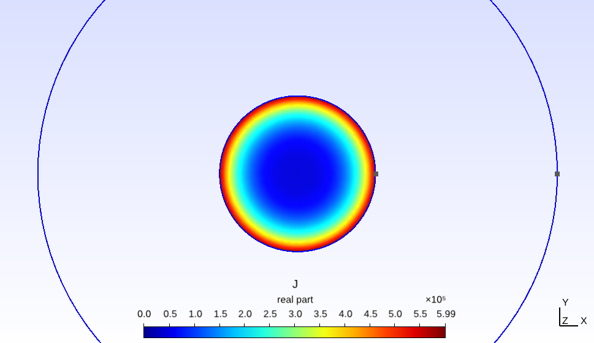

# Formulations
This folder contains a series of example models for the magnetoquasistatics formulation. 

They are loosely based on the GetDP tutotrials (4, 6, 7, 8, 10 in particular), with the main difference being that the DtDof operator and the F_Sin_wt_p[] and F_Cos_wt_p[] functions in GetDP are not used.

